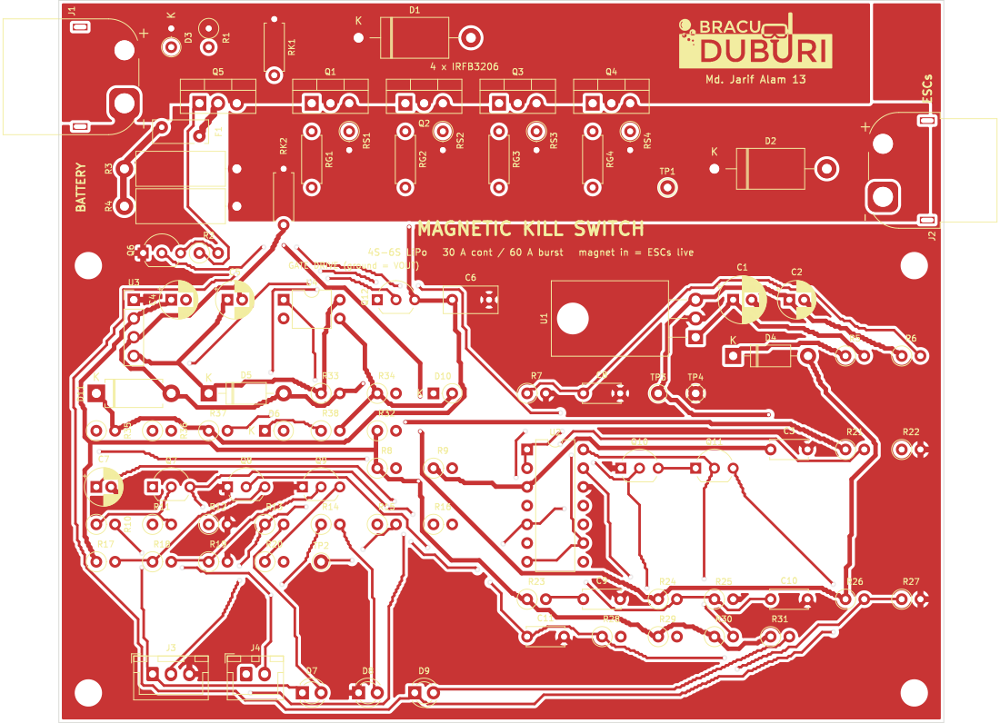

# Magnetic Kill Switch

Magnetic kill switch for an underwater robot on a 4S–6S LiPo. The board sits inside the hull and the magnet plug sits outside. Plug in: the ESCs get power. Pull the plug out: power is cut about 1.6 ms later.

There are two versions in this repository:

| | Through-hole (main) | SMD (first version) |
|---|---|---|
| Board | `kicad/ks_tht.kicad_pcb`, 120 × 98 mm | `kicad/ks_power.kicad_pcb`, 118 × 120 mm |
| Parts | 95 (4 of them test pads), all through-hole | 117, SMD (TOLL, MSOP, 0603) |
| Battery and ESC side | XT60 in, XT60 out | M5 ring lugs |
| Current | 30 A continuous / 60 A burst (XT60 rating) | 100 A continuous / 150 A burst |
| Switch | 4 × IRFB3206 (TO-220) | 8 × IPT007N06N (TOLL) |
| Controller | one LM339 + isolated gate supply | LM5060 |

**Neither board has been built or tested yet.** Everything below comes from calculations, KiCad DRC (0 violations, 0 unconnected on both boards) and ngspice simulations of the netlists taken from the PCBs.



## Why no reed switch in the power path

A reed switch carries well under 1 A. Even large Littelfuse/Hamlin reeds are rated around 1–3 A and burn at the arc of a DC break at tens of amps. So the magnet only drives sensors. The current is switched by MOSFETs.

## Through-hole board: how it works

1. **Two sensors in series.** A Hall module (KY-003, A3144) and a reed door contact (MC-38) must both see the magnet before anything turns on. A Hall stuck on, a welded reed, a cut cable, a Hall without power or a shorted Hall wire still kill (all simulated).
2. **Arm delay and debounce.** The sensors pull ARM high. ARM charges EN through 100 kΩ / 10 µF, so the switch starts about 0.8 s after the plug goes in. Losing ARM empties EN through a 2N3904 in about 1.5 ms, so a sensor gap shorter than about 1 ms (vibration) is ignored and a real pull kills in 1.6 ms.
3. **Pre-charge first.** An IRF9540N charges the ESC capacitors through a 0.5 A PTC and 2 × 22 Ω (1.4 A at 4S, 2.1 A at 6S) instead of a few hundred amps into cold capacitors.
4. **One LM339 does the sequencing.**
   - EN above 2.5 V starts the pre-charge.
   - If VOUT does not keep up with a ramp that rises with VIN (a shorted ESC bus), the pre-charge stops and stays off until the magnet is pulled.
   - The main MOSFETs close only when VOUT is above half of VIN.
   - The same comparator trips when a short pulls VOUT down while running.
5. **Main switch.** 4 × IRFB3206 in parallel as a high-side switch. The gate supply is an isolated 5 V → 12 V module (B0512S) whose output floats on the MOSFET sources, so the gates get about 13 V on any pack. A PC817 connects it to the gates through a diode and 10 kΩ; a 220 nF capacitor makes VOUT ramp up gently (19 A peak when the MOSFETs close). When the opto lets go, a BC327 pulls the gates down fast.
6. **Clamps.** 1.5KE33A TVS on the battery and ESC sides, P6KE18A between gate and source, 15 V zener on the gate supply.
7. **LEDs.** Blue HALL and blue REED (each sensor sees the magnet) and red LIVE (ESCs powered).

What this medium version leaves out (to keep it at 95 parts): under- and over-voltage lockout, a second opto kill path that works even if the comparator side is stuck on, an over-current trip below a hard short, and a status line to the Jetson. **Put a 40 A fuse (blade or MIDI) in the battery + lead**: the board kills a hard short in under 0.5 ms, but an overload (say 50 A for a minute) is the fuse's job.

## Numbers (through-hole board)

| | Value |
|---|---|
| MOSFET drop, 4 in parallel | 25 mV at 30 A, 50 mV at 60 A |
| Heat in the MOSFETs | 0.75 W at 30 A (0.19 W each), 3 W at 60 A burst |
| Gate voltage | 13.3 V on 4S and 6S |
| Kill time after the magnet leaves | 1.5–1.6 ms, also with any one sensor fault |
| Ignored sensor gap | 0.8 ms tested (vibration) |
| Short on the ESC side while live | off in 0.44 ms (4S) / 0.47 ms (6S); 1.1 J / 2.5 J shared by the 4 MOSFETs |
| Magnet in with the ESC side shorted | never turns on; 0.29 J in the pre-charge resistors |
| Battery spike when killing 60 A | 17.7 V peak on 4S, 26.1 V on 6S |

All 15 scenarios: [`kicad/simulation/summary_tht.md`](kicad/simulation/summary_tht.md). Magnet field, sensor placement and plug retention: [`calc/report.md`](calc/report.md).

## Buying (through-hole board)

Full list with quantities: [`kicad/bom_tht_grouped.csv`](kicad/bom_tht_grouped.csv). The main parts:

- 4 × IRFB3206PbF (TO-220), 1 × IRF9540NPbF.
- Mornsun B0512S-1WR3 (5 V → 12 V isolated, SIP-4). Check its pin order against the board: 1 GND, 2 Vin, 3 0 V, 4 +Vo.
- LM339N (DIP-14), PC817 (DIP-4), L7805CV. A K7805-500R3 or R-78E5.0-0.5 switching module fits the 7805's holes and runs cooler on 6S.
- 2 × 1.5KE33A, P6KE18A, 1N4744A, 1N4007, 2 × 1N4148, BZX55C12.
- Littelfuse RXEF050 PTC, 2 × 22 Ω 2 W.
- AMASS XT60PW-M (battery side) and XT60PW-F (ESC side), right-angle PCB mount.
- KY-003 Hall module. Check its pin order (S, +, −) with a multimeter: some clones swap + and −.
- MC-38 wired door contact, sold in Bangladesh ([ElectronicsBD](https://electronics.com.bd/components-price-in-Bangladesh/mc-38-wired-door-window-sensor-magnetic-switch-home-alarm-system), [BDTronics](https://www.bdtronics.com/mc38-magnetic-switch.html)). Listings disagree on "normally open" and "normally closed", so check with a multimeter: it must close when the magnet is near. Any normally-open glass reed switch also works on J4.
- N52 magnet, 15 mm diameter × 10 mm, axially magnetised.

The XT60 is rated 30 A continuous and 60 A for under a minute ([Holybro connector ratings](https://docs.holybro.com/power-module-and-pdb/power-module/connector-and-wire-rating)). For more current, use the SMD board (100 A / 150 A).

## Wiring (through-hole board)

- Battery → 40 A fuse → J1 (XT60, battery side). ESC harness → J2 (XT60, ESC side). The ground passes through the board from J1 to J2 on the bottom-layer plane.
- J3 → KY-003 (1 = S, 2 = +, 3 = −). J4 → MC-38 (2 wires, either way round).
- Run the battery + and − as a twisted pair, at least 10 cm from the sensors.
- There is no reverse-polarity protection on the power path. The XT60 is keyed, so keep it that way.

## Mechanics (side mount)

- The dock is glued to the outside of the hull (no holes through the hull). The hull wall must be non-magnetic: acrylic, polycarbonate or aluminium, not steel.
- The plug carries the magnet with its **south pole toward the hull**: the A3144 only reacts to a south pole on its printed face. If the HALL LED stays off with the plug in, flip the magnet.
- An O-ring on the plug snaps into a groove in the dock: 10–20 N to pull out, against 0.29 N of plug weight, 1.4 N at 5 g of vibration and 1.2 N of water drag at 1.5 m/s. A slot along the dock bore lets water in and out, so there is no suction and no trapped water.
- Inside, a printed bracket holds the A3144 flat against the wall on the plug's axis (9.5 mm from the magnet, about 104 mT, 3× margin) and the MC-38 12 mm off the axis. Centred on the axis the reed would see no field along its length.
- Keep steel away from the sensors. Park the pulled plug at least 120 mm away (30 cm is better), never on a steel part.

## Pre-dive check

1. Plug out, battery in: all three LEDs off.
2. Push the plug in: both blue LEDs (HALL, REED) on, then about 1 s later the red LIVE LED on. If only one blue LED lights, do not dive.
3. Pull the plug: LIVE off at once, the thrusters stop.
4. Pull the plug with a luggage scale once: it should need 10–20 N.

## Check before trusting it

- Build one board and test it on a bench supply with a current limit first, then with the battery and one ESC, then at full current.
- Measure the KY-003 and MC-38 with the magnet: KY-003 modules use A3144 or clones (operate about 7–35 mT, release 5–33 mT), and reed sensitivity varies by maker.
- The B0512S output is unregulated (about 14 V at light load in the model); the 15 V zener and the P6KE18A keep the gate below 20 V. In the 6S hard-short case the simulated gate peak is 19.7 V, close to the IRFB3206's 20 V limit.
- The simulation models (MOSFETs fitted to datasheet numbers, behavioural comparators, opto, isolated module) are approximations.

## Folders

| Folder / file | Contents |
|---|---|
| `kicad/build_tht.py`, `route_tht.py` | Through-hole board: parts, netlist and placement; routing (0/45/90-degree tracks only), pours, BRACU Duburi logo and name, DRC |
| `kicad/ks_tht.*`, `drc_tht.rpt`, `bom_tht*.csv` | Through-hole KiCad board, DRC report, BOM and order list |
| `kicad/simulation/run_tht.py`, `models_tht.lib`, `summary_tht.md` | Through-hole simulation: 15 scenarios from the PCB netlist |
| `gerber_tht/`, `kill_switch_tht_*.zip` | Through-hole gerbers for JLCPCB (2 layers, 2 oz copper) and the KiCad project |
| `kicad/build_ks.py`, `route_ks.py`, `ks_power.*` | SMD board (100 A / 150 A, LM5060) |
| `kicad/simulation/run_ks.py`, `summary.md` | SMD board simulation, 15 scenarios |
| `gerber/`, `kill_switch_gerber_jlcpcb.zip`, `kill_switch_kicad.zip` | SMD gerbers and KiCad project |
| `calc/` | `design_calc.py`: magnet field (exact loop model), reed placement, cable stray field, losses, timing, plug retention (`report.md`) |

## Rebuilding (through-hole board)

With KiCad 7 and its Python (`KICAD7_FOOTPRINT_DIR` and `KICAD7_SYMBOL_DIR` set to the KiCad libraries):

```bash
cd kicad && python3 build_tht.py && python3 route_tht.py && python3 make_bom.py bom_tht.csv bom_tht_grouped.csv
```

```bash
cd kicad/simulation && python3 run_tht.py && python3 summary_tht.py
```

## Bangla-English summary

- Notun board puro through-hole: battery ar ESC dui dikei XT60, 4 ta IRFB3206, 95 ta part.
- XT60-er rating 30 A continuous / 60 A burst, tai board-o sei hisebe. Battery-r + tar-e 40 A fuse din.
- Hall (KY-003) ar reed (MC-38) dutoi magnet dekhle tobei chalu hoy. Jekono ekta noshto holeo magnet tanle power off hoy (1.6 ms).
- Magnet dhukale age pre-charge (1.4–2.1 A), tarpor ~0.8 s pore MOSFET. ESC side short thakle chalu-i hoy na; chalu obosthay short hole 0.44 ms-e off.
- 30 A-te MOSFET-e mat 0.75 W gorom.
- Track gulo 45°-e ghora, kono 90° kona nei. Upore BRACU Duburi logo ar nam ache.
- Board ekhono banano/test kora hoyni: prothome bench supply-te current limit diye test korben.
