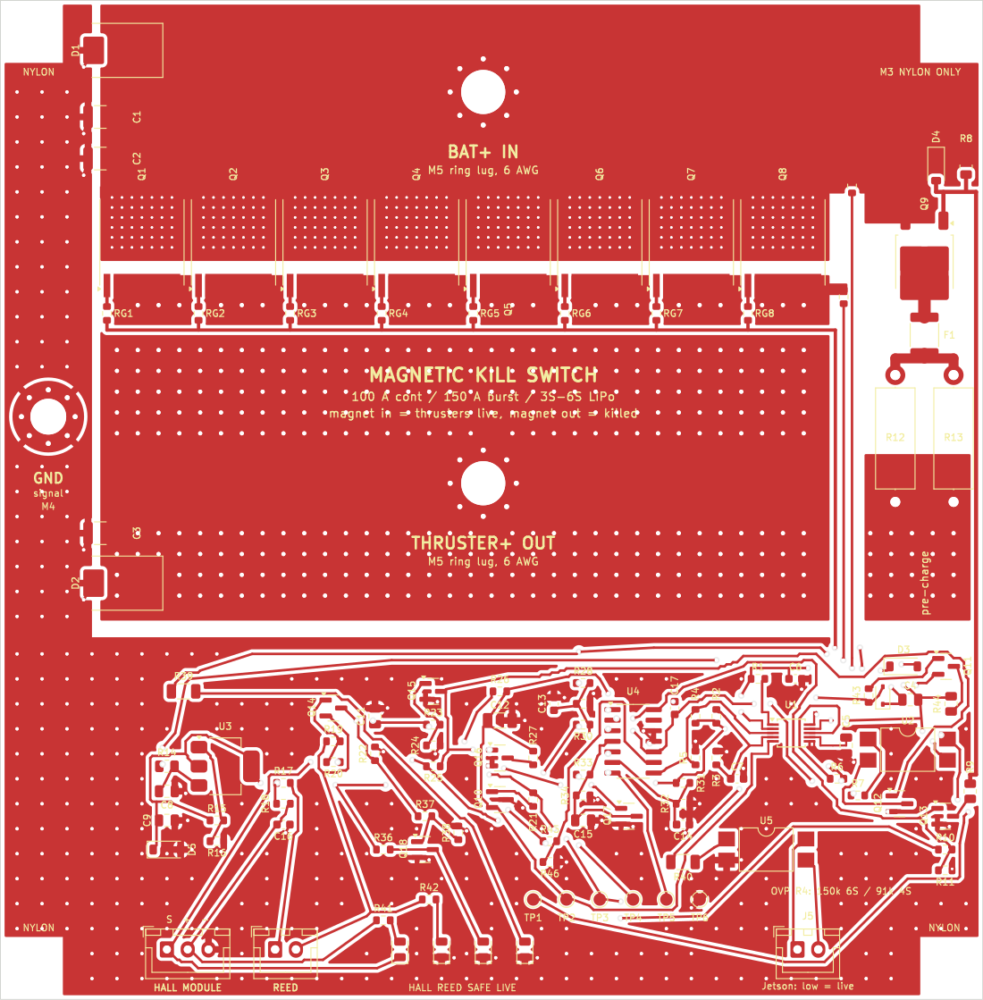

# Magnetic Kill Switch (100 A continuous, 150 A burst)

Solid-state magnetic kill switch for an underwater robot running on a 3S–6S LiPo. The board sits inside the hull and the magnet plug sits outside. Plug in: the thrusters get power. Pull the plug out: power is cut about 5 ms later.

**This board has not been built or tested on hardware yet.** Everything below comes from calculations, KiCad DRC (0 violations, 0 unconnected) and ngspice simulation of the netlist taken from the PCB.



## Why no reed switch in the power path

A reed switch carries well under 1 A. Even the large Littelfuse/Hamlin reeds are rated around 1–3 A and burn at the arc of a 100 A DC break. So the magnet only drives sensors. The 150 A is switched by eight MOSFETs in parallel.

## How it works

1. **Two different sensors in series.** A Hall module (KY-003, A3144) and a reed contact (MC-38) must both see the magnet before anything turns on. A Hall stuck on, a welded reed, a cut cable, a dead sensor supply or a shorted signal wire all still kill (simulated, see below).
2. **Arm delay and debounce.** The two sensors drive the ARM line. ARM charges EN through 100 kΩ / 22 µF, so the switch turns on about 1 s after the plug goes in. A gap shorter than about 0.9 ms (vibration, reed chatter) is ignored. A real pull discharges EN at once.
3. **Pre-charge first.** A P-FET (FQD11P06) charges the ESC capacitors through a 0.5 A PTC and 11 Ω (1.5 A at 4S, 2.3 A at 6S). Switching hard into the capacitors would draw about 640 A. An LM339 stops the pre-charge if the output does not rise (shorted thruster bus) or if the pack voltage is too high (OVP). It lets the main switch close only when VOUT is above half of VIN.
4. **Main switch.** Eight Infineon IPT007N06N (60 V, 0.75 mΩ max, TOLL) in parallel, driven by an LM5060 high-side controller (charge pump, UVLO, OVP, short-circuit trip on V<sub>DS</sub>, fault timer).
5. **Fast, controlled turn-off.** The LM5060 sinks only about 2 mA from the gates, so turning off at 150 A would take about 1 ms in the Miller plateau. A PNP (Q11) pulls the gate bus to the source through 220 Ω instead: plateau about 18 µs, 22 mJ in the MOSFETs. TVS diodes (SMDJ26A on VIN, SMCJ26A on VOUT) take the energy left in the battery and thruster cables.
6. **Second kill path.** If the controller itself is stuck on, an optocoupler (U2) shunts the gates to the source when the sensors drop out.
7. **Status.** LEDs show HALL, REED, SAFE (green) and LIVE (red). An isolated output (J5, PC817) tells the Jetson whether the thrusters are live.

## Numbers

| | Value |
|---|---|
| MOSFET resistance, 8 in parallel, hot | 116 µΩ |
| Heat at 100 A | 1.2 W in the MOSFETs (0.17 W each), 2.4 W for the board |
| Heat at 150 A | 2.6 W in the MOSFETs, junction about 62 °C with the board at 60 °C |
| Simulated V<sub>DS</sub> | 9.1 mV at 100 A, 13.7 mV at 150 A, V<sub>GS</sub> 12.8 V |
| Kill time after the magnet leaves | 4.3–5.0 ms (all sensor and controller faults included) |
| Short on the output while live | off in 0.82 ms, 1.9 J shared by the 8 MOSFETs |
| Short-circuit trip | 417 A or more (150 A gives about 21 mV against a 59–78 mV trip) |
| Under-voltage lockout | 9.4 V rising, 8.1 V falling |
| Over-voltage | 32 V (R4 = 150 kΩ, 6S, default) or 20.2 V (R4 = 91 kΩ, 4S) |
| Field at the Hall sensor | 104 mT with the weakest N52 grade: 3× the A3144's highest operate point |
| Plug retention on a vertical wall | 10–20 N pull-out, 35× the plug's own weight |

Details: [`calc/report.md`](calc/report.md) (all design numbers) and [`kicad/simulation/summary.md`](kicad/simulation/summary.md) (all 15 simulated scenarios pass).

## Compared with what other teams do

| Team (source) | What they do | Problem it leaves |
|---|---|---|
| Stanford AUV, RoboSub 2026 ([TDR](https://robonation.org/app/uploads/sites/4/2026/07/RS26_TDR_StanfordAUV.pdf)) | Blue Robotics switch to a hardware interrupt that sets all ESC PWM to neutral. They ruled out relays (size) and solid-state switches (heat). | Battery power stays on the ESCs. A crashed MCU or a confused ESC can still spin a thruster. |
| UC Davis, RoboSub 2026 ([TDR](https://robonation.org/app/uploads/sites/4/2026/07/RS26_TDR_UCDavid_CycloneRoboSub.pdf)) | Reed switch and a neodymium magnet, RC filter against false trips, cuts the high-power lines. | One sensor: a welded reed means no kill. |
| UCLA, RoboSub 2026 ([TDR](https://robonation.org/app/uploads/sites/4/2026/07/RS26_TDR_ASMEatUCLA.pdf)) | Door-alarm style magnetic contact in line with the old switch. | Same single-sensor problem. |
| Ohio State UWRT ([navionics](https://org.osu.edu/osu-uwrt/navionics-team/)) | Kill circuit on the power board, fail-open relays held on by the kill switch's 5 V. | Relays: coil power, size, contact wear at 100 A DC. |
| Cornell AutoBoat, surface boat ([electrical](https://cornellautoboat.vercel.app/technical/electrical-systems)) | Kill button switches relays through a MOSFET with a charge pump. | Relays again. |
| Illinois AUV ESC board ([portfolio page](https://portfolio-bvs.pages.dev/projects/killswitch_pcb)) | Hall-effect kill switch switching P-channel MOSFETs. | P-FETs: 3× IRF4905 at 100 A dissipate about 67 W. |
| Hall kill switch notes on [HackMD](https://hackmd.io/@N9nan/BJDmv7dVi) | AH180N Hall IC; the flexible-PCB version was replaced with a rigid PCB for durability. | One sensor. |

What this design adds: two different sensors in series, the real battery current switched (not only PWM), pre-charge with short detection, a controlled 18 µs turn-off with TVS clamps, short-circuit and over-voltage protection, a second kill path, and about 1.2 W of heat at 100 A instead of 55–67 W (TO-220 MOSFET arrays) or about 7 W (a contactor coil).

## Folders

| Folder / file | Contents |
|---|---|
| `calc/` | `design_calc.py`: magnet field (exact loop model), reed placement, cable stray field, losses, LM5060 resistors, pre-charge, turn-off, cable impedance, plug retention. Writes `results.json` and `report.md`. |
| `kicad/` | `ks_power.kicad_pcb` (2 layers, 2 oz, 118 × 120 mm), built by `build_ks.py` and routed by `route_ks.py` + `gridroute.py`; DRC report; `bom_power.csv` and the order list `bom_grouped.csv` (`make_bom.py`) |
| `kicad/simulation/` | `run_ks.py` (15 scenarios, netlist taken from the PCB), `models_ks.lib`, `results.json`, `summary.md` |
| `gerber/` | Gerber and drill files for JLCPCB (2 layers, 2 oz copper) |
| `mech/` | Magnet plug, dock and inside sensor bracket (OpenSCAD) |
| `3d/` | 3D tutorial: a person pulls the plug and puts it back, with the LEDs and thrusters reacting; video `kill_switch_tutorial.mp4` |
| `pcb-3d/` | 3D board with the current paths and every part explained |
| `veroboard/` | Hand-built version: control circuit on perfboard, MOSFETs on copper bus bars |
| `kill_switch_*.zip` | Gerbers for JLCPCB and the KiCad project |

## Buying

Full list with quantities: [`kicad/bom_grouped.csv`](kicad/bom_grouped.csv). The parts that matter most:

- 8 × Infineon IPT007N06N (TOLL). No substitutes with more resistance: the heat goes up with the square of the current.
- TI LM5060MM/NOPB, LM339 (SOIC-14), FQD11P06, 2 × PC817 SMD, LM317 (SOT-223).
- Littelfuse SMDJ26A (VIN) and SMCJ26A (VOUT).
- 1812 PTC, 0.5 A hold, rated 30 V or more (60 V for 6S).
- KY-003 Hall module. Check its pin order (S, +, −) with a multimeter: some clones swap + and −.
- MC-38 wired door contact, the type that is **closed** when the magnet is near (normally open). Leave its own magnet in the drawer.
- N52 magnet, 15 mm diameter × 10 mm, axially magnetised.
- A 150 A MIDI or ANL fuse right at the battery. The kill switch is not a fuse.

## Wiring

- Battery + → 150 A fuse → `BAT+ IN` (M5, 6 AWG). `THRUSTER+ OUT` (M5, 6 AWG) → the ESC + bus.
- ESC minus wires go straight to the battery minus, not through the board. `GND` (M4) takes a thin wire to the battery minus (logic ground only).
- Run the battery + and − as a twisted pair, at least 10 cm from the sensors (150 A in one lone wire makes 0.3 mT at 10 cm; a pair makes 0.04 mT).
- J4 → KY-003 (1 = S, 2 = +, 3 = −). J6 → MC-38 (2 wires, either way round). J5 → Jetson (opto output: low = live).
- R4 sets the over-voltage limit: 150 kΩ for 6S (default), 91 kΩ for 4S.
- There is no reverse-polarity protection. Use keyed battery connectors.

## Mechanics (side mount)

- The dock is glued to the outside of the hull (no holes through the hull). The hull wall must be non-magnetic: acrylic, polycarbonate or aluminium, not steel.
- The plug carries the magnet with its **south pole toward the hull**: the A3144 only reacts to a south pole on its printed face. If the HALL LED stays off with the plug in, flip the magnet.
- An O-ring on the plug snaps into a groove in the dock: 10–20 N to pull out, against 0.29 N of plug weight, 1.4 N at 5 g of vibration and 1.2 N of water drag at 1.5 m/s. A slot along the dock bore lets water in and out, so there is no suction and no trapped water.
- Inside, a printed bracket holds the A3144 flat against the wall on the plug's axis (9.5 mm from the magnet) and the MC-38 12 mm off the axis. Centred on the axis the reed would see no field along its length.
- Keep steel away from the sensors. Park the pulled plug at least 120 mm away (30 cm is better), never on a steel part.

## Pre-dive check

1. Plug out, battery in: green SAFE on, red LIVE off, both blue LEDs off.
2. Push the plug in: both blue LEDs (HALL, REED) on, then about 1 s later LIVE on and SAFE off. If only one blue LED lights, do not dive.
3. Pull the plug: LIVE off and SAFE on at once, the thrusters stop.
4. Pull the plug with a luggage scale once: it should need 10–20 N.
5. Check that the Jetson sees the status change on J5.

## Check before trusting it

- The LM5060 numbers (sense current, timer currents, thresholds) partly come from secondary copies of the TI datasheet. Check them against the current TI datasheet.
- KY-003 modules use A3144 or clones: operate about 7–35 mT, release 5–33 mT. Measure yours with the magnet.
- MC-38 contact rating and reed sensitivity vary by maker. Test the release distance.
- PTC voltage rating and the SMDJ26A/SMCJ26A clamp voltages: check the exact part you buy.
- Build one board, test it on a bench supply with a current limit first, then with the battery and one ESC, then at full current.

## Rebuilding

With KiCad 7 and its Python (`KICAD7_FOOTPRINT_DIR` and `KICAD7_SYMBOL_DIR` set to the KiCad libraries):

```bash
cd calc && python3 design_calc.py
```

```bash
cd kicad && python3 build_ks.py && python3 route_ks.py && python3 make_bom.py
```

```bash
cd kicad/simulation && python3 run_ks.py && python3 summary.py
```

## Bangla-English summary

- Reed switch 100 A nite parbe na (1–3 A max), tai magnet shudhu sensor chalay; 150 A katche 8 ta IPT007N06N MOSFET.
- Hall (KY-003) ar reed (MC-38) dutoi magnet dekhle tobei chalu hoy; jekono ekta noshto holeo magnet tanle power off (simulation-e check kora).
- Magnet dhukale: age pre-charge (1.5–2.3 A), tarpor ~1 s pore main switch. Magnet tanle ~5 ms-e off.
- 100 A-te MOSFET-e mat 1.2 W gorom (onno team-er TO-220 design-e 55–67 W).
- Plug-e O-ring detent: pashe lagale nijer ojone porbe na (10–20 N lage tante).
- Board ekhono banano/test kora hoyni: prothome bench supply-te current limit diye test korben.
